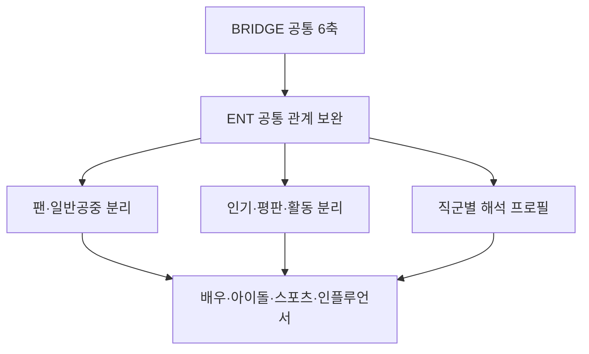
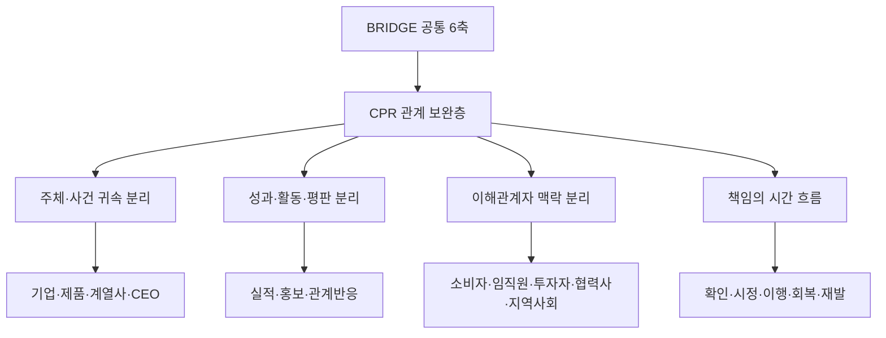

# BRIDGE 2단 방법론 구조

상태: 확정 원칙  
확정일: 2026-10-20  
적용 순서: UNI → GOV → ENT → CPR

## 1. 1차 공통층

CPR, GOV, UNI, ENT 모두에 동일한 BRIDGE 공통 골격을 적용한다.

- B·R·I·D·G·E 여섯 축
- 근거 원장과 대상·축·날짜 연결
- 동일 사건 중복 제거
- 직접 관측값, 유지값, 추정값, 참조값의 구분
- 신뢰등급과 관측 범위
- 시점, 버전, 정정 이력 관리
- 공통 공개 적격 기준과 재현성 검증

공통층은 분야 간 비교 가능성과 방법론적 일관성을 보장한다.

## 2. 2차 분야별 보완층

공통 철학과 점수 골격은 유지하되 CPR, GOV, UNI, ENT 각각의 관계 특성에 맞는 조작적 정의, 근거 유형, 귀속 규칙, 시간 구조를 보완한다. 분야마다 별개의 지수를 만드는 것이 아니라 공통 골격의 관측 정확도를 높이는 부분 맞춤형 계층이다.

### GOV 확정 보완

- 기능 맥락: 규제·서비스·지원·정책조정·지방행정의 관계 차이를 진단하되 가중치는 임의 변경하지 않는다.
- 경험 경로: 직접 서비스 경험, 제도 경험, 매체 경험, 대리 경험을 구분한다.
- E: 적법성, 절차적 공정성, 설명책임, 의견수렴 및 확인·계획·집행·감사·시정·재발의 생애주기
- R: 국민·주민 참여, 응답성, 상호통제, 의견의 실제 반영
- G: 기관간·민관 협업의 실제 공동 이행; 단순 업무협약은 낮은 강도의 연결 근거로만 기록
- D: 민원·신청·상담·신고·급부·허가·단속 등 직접 또는 의무적 공공서비스 경험
- 보조 진단: 이미지-실적 정합성과 공식 설명-외부 경험 정합성
- 혁신·ESG·전문성은 수상·홍보 표현이 아니라 공개적으로 확인된 행동과 결과가 있을 때만 관계 신호로 인정한다.

### UNI 확정 보완

- R: 신뢰, 만족, 상호성, 불신, 불만, 관계이탈
- I: 대학의 공식 정체성과 외부의 반복 연상 사이의 일치
- E: 사건의 시정, 이행, 회복, 재발이라는 시간 흐름
- B: 독립적 발견과 동일 사건의 반복 전재 구분

### ENT 확정 보완

ENT는 공통 BRIDGE 6축과 공통 가중치·공개 적격 기준을 유지하면서, 팬덤과 일반 공중의 관계 구조, 인기·활동·평판의 경계, 직군별 본업 맥락, 빠른 대상 변화를 2차 보완층에서 해석한다.



- B: 팬덤 반복확산과 독립적 발견, 팬덤 내부 순환과 일반 공중 확장을 구분한다.
- R: 직접 소통, 응답성, 상호성, 관계 긴장·이탈·회복을 구분한다.
- I: 공식 콘셉트·정체성과 외부 반복 연상 및 팬덤 상징의 관계를 진단한다.
- D: 관심이 시청·관람·예매·구독·구매·투표·팬 프로젝트로 이어지는 행동 경로를 기록한다.
- G: 배우·아이돌/가수·스포츠 스타·인플루언서/방송인의 직군별 본업 맥락을 구분하되, 절대 능력평가로 확대하지 않는다.
- E: 확인·설명·조사·중단·시정·복귀·회복·재발의 시간 흐름과 실제 기부·봉사·사회공헌을 기록한다.
- 외모, 확인되지 않은 사생활, 비공개 산업 네트워크, 루머, 팬덤의 독립 행동은 공개 점수에 직접 귀속하지 않는다.
- ENT B-AN20은 NEW·SURGE·SHIFT 후보를 민감하게 탐지하는 조기관측층으로 운용하고, 화제 발생만으로 높은 평판이나 T100 진입을 단정하지 않는다.
- 신규 후보 탐색은 기존 명단에 한정하지 않으며, 별칭·멤버·소속사·동명이인 귀속과 동일 사건 반복 전재를 검증한다.
- 세부 수집어와 내부 판단 규칙은 지식재산 및 조작 방지를 위해 공개 문서에서 원문 그대로 노출하지 않는다.

### CPR 확정 보완

CPR은 공통 BRIDGE 6축과 공통 가중치·공개 적격 기준을 유지하면서, 기업·제품·계열사·CEO 귀속, 기업성과·활동·평판의 경계, 이해관계자별 관계, 약속과 행동의 일치, 책임의 시간 흐름을 2차 보완층에서 해석한다.



- B: 기업발 보도자료·광고와 독립 취재·독립 평가를 구분하고, 동일 자료의 반복 전재와 복수의 독립 발견을 분리한다.
- R: 신뢰·만족·상호성·공정성·헌신과 불신·불만·갈등·이탈을 소비자·임직원·투자자·협력사·지역사회 등 이해관계자 맥락과 함께 기록한다.
- I: 공식 미션·비전·핵심가치 및 브랜드 약속과 실제 행동·외부 반복 연상의 일치 또는 충돌을 진단한다.
- D: 관심과 호감이 추천·재구매·구독·참여 또는 환불·해지·불매·분쟁·거래 중단으로 이어지는 행동 경로를 기록한다.
- G: 품질·서비스·고객지원·보안·공급·혁신의 실제 이행을 업종 맥락에서 기록하되, 절대적 기업 능력·투자 가치 평가로 확대하지 않는다.
- E: 확인·설명·조사·리콜·보상·시정·이행·회복·재발의 생애주기와 환경·인권·공정거래·소비자 보호·준법·윤리·투명성의 실제 이행을 기록한다.
- 기업·제품·계열사·CEO·임직원·협력사 사건은 동일하게 합산하지 않으며, 기업의 공식 책임·의사결정·대응과 직접 연결될 때만 기업에 귀속한다.
- 매출·영업이익·주가·시가총액·판매량·시장점유율·광고량·수상·ESG 선언은 평판점수에 자동 가점하지 않는다.
- NCSI·KCSI·K-BPI·ESG 평가 등 외부 지표는 직접 입력값보다 수렴타당도와 외부 타당화 자료로 우선 사용한다.
- 내부 근거에는 공중, 주체, 출처, 증거 단계, 업종 맥락 태그를 보존하되 세부 수집어와 내부 판단 규칙은 공개하지 않는다.

## 3. 변경 통제

- 분야별 보완은 공통 축의 의미를 훼손하거나 임의의 새 축을 만들지 않는다.
- 내부 가중치, 임계값, 공개 적격 기준은 별도 검증 없이 변경하지 않는다.
- 동일 입력에 대해 기존 결과와 보강 결과를 병행 산출하여 순위·점수 안정성과 설명력 개선을 검증한다.
- 자료가 없거나 수집에 실패한 값을 추정하여 채우지 않는다.
- 분야별 보완 근거는 원장부터 점수, 공개 JSON, 화면까지 추적 가능해야 한다.
- 보완층의 효과는 구성타당도, 변별타당도, 수렴타당도, 사건타당도, 강건성, 결측 편향, 귀속 정확도, 시간 안정성으로 검증한다.

## 4. 향후 문서화 의무

사용자가 백서, 운영 매뉴얼 또는 검증 프레임워크의 상세 개정을 요청하면 다음 내용을 반드시 포함한다.

1. 공통층과 분야별 보완층의 목적 및 경계
2. 분야별 공중 범위와 조작적 정의
3. 수집 가능한 근거와 제외 기준
4. 원장 기록 및 중복·귀속 처리
5. 점수 반영 여부와 변경 통제
6. 보강 전후 병행 검증 절차
7. 공개 가능한 설명과 비공개 지식재산의 경계
8. 한계, 정정, 버전 및 재현성 관리

## Weekly six-axis observability contract — effective 2026-W43

The two-layer model is operationally complete only when every active entity and
each B·R·I·D·G·E axis is checked during the Monday-Sunday week. A check does
not force a score. It produces one auditable internal state:

- O (new observation): new valid evidence was measured during the week.
- M (verified maintenance): prior evidence was rechecked and remains valid.
- R (confirmed reference): collection completed but no valid entity-level
  evaluation value was available. The display reference is excluded from score
  and rank.
- F (collection failure): collection or attribution verification was not
  completed. F is an operating defect, not evidence about reputation.

Weekly collection completion and score coverage are different measures. A week
may be collection-complete at 6/6 while only 5/6 axes are score-available.
Reference never becomes a neutral score merely because the calendar closes.

Consecutive R states trigger internal remediation: supplementary-source search
at two weeks, attribution/alias review at three weeks, operational-definition
review at four weeks, and measurement-design review at six weeks. Weekly and
monthly reporting must retain axis coverage alongside level indices.


## 5. 백서·매뉴얼 반영을 위한 기준 원본

이 절은 향후 BRIDGE 백서, 운영 매뉴얼, 검증 프레임워크를 개정할 때 생략 없이 전개해야 하는 기준 원본이다.

### 5.1 2단 구조의 당위성

단일 공통모형만 사용하면 분야 간 일관성은 확보되지만 대학·공공기관·공인·기업의 서로 다른 공중, 관계경로, 사건생애주기와 귀속단위를 충분히 포착하지 못한다. 반대로 분야별로 독립된 지수를 만들면 축의 의미와 점수 해석이 달라져 비교 가능성, 재현성, 변경통제가 약화된다.

따라서 BRIDGE는 다음을 동시에 만족시키는 2단 구조를 채택한다.

1. **공통성:** 동일한 6축, 원장, 중복 제거, 상태·신뢰·시점·버전 규칙으로 방법론적 일관성을 보장한다.
2. **현실 적합성:** 분야별 공중과 관계경로를 조작적으로 정의하여 실제 관측 타당성을 높인다.
3. **추적성:** 분야별 보완이 어떤 근거를 어떤 축에 반영했는지 대상·축·날짜 단위로 역추적한다.
4. **변경 안정성:** 보완층은 새 점수체계를 만드는 것이 아니라 동일 공통 골격의 관측 정확도를 높인다.

### 5.2 1차 공통층의 판정 기준

모든 입력은 다음 순서를 통과해야 한다.

```text
공개 근거 수집
→ 대상·공중·사건·출처·시점 식별
→ 동일 사건 및 반복 전재 중복 제거
→ 대상 귀속과 축 귀속 검증
→ 근거 상태(O/M/R/F) 및 신뢰도 판정
→ 유효 축값 산출
→ 유효 축만으로 당일 종합지수 산출
→ 공개 적격성·순위·설명문 생성
→ 원장-점수-공개 JSON-화면 연결 검증
```

공통층의 필요조건은 다음과 같다.

- 근거는 대상, 축, 관측일, 출처, 사건 식별자와 연결된다.
- 동일 사건의 반복 전재는 독립 사건 수로 중복 계산하지 않는다.
- 직접 관측과 유효기간 내 유지, 참조, 수집 실패를 분리한다.
- 참조는 화면의 중립선일 뿐 점수 50으로 투입하지 않는다.
- 수집 실패는 평판 상태가 아니라 운영 결함으로 처리한다.
- 공통 가중치, 임계값, 공개 적격 기준은 검증·승인 없이 바꾸지 않는다.
- 산출물은 방법론 버전과 기준시점을 보존한다.

### 5.3 2차 보완층의 판정 기준

분야별 보완 요인은 다음 조건을 모두 충족할 때만 공통 축에 연결한다.

1. 해당 분야에서 공중과 대상 사이의 관계를 설명하는가.
2. 기존 BRIDGE 축의 개념 안에서 해석 가능하며 임의의 새 축을 만들지 않는가.
3. 공개적·반복적으로 수집 가능한 근거가 존재하는가.
4. 대상·공중·사건·시점 귀속을 검증할 수 있는가.
5. 단순 활동량, 인기, 능력, 실적을 관계 평판으로 자동 치환하지 않는가.
6. 기존 결과와 병행 산출했을 때 설명력은 개선되고 점수·순위가 비정상적으로 흔들리지 않는가.

### 5.4 개념적 산출식

세부 가중치와 임계값은 지식재산 및 조작 방지를 위해 비공개로 유지하되, 백서에는 다음 개념적 구조를 공개한다.

축 (a), 대상 (i), 기준일 (t)에 대해 유효 근거 집합을 (E_{i,a,t}^{*})라 하면, 중복 제거·귀속·시점·신뢰 보정을 거친 축값은 다음과 같이 표현한다.

[
A_{i,a,t}
=
mathcal{N}_{a}
left(
rac{
sum_{e in E_{i,a,t}^{*}}
q_e d_e r_e s_e x_e
}{
sum_{e in E_{i,a,t}^{*}}
q_e d_e r_e s_e
}

ight)
]

- (x_e): 근거가 나타내는 방향과 강도
- (q_e): 출처 및 근거 품질
- (d_e): 시간 감쇠·유효기간
- (r_e): 대상·사건·공중 귀속 신뢰도
- (s_e): 독립성 및 중복 제거 보정
- (mathcal{N}_{a}): 축별 정규화 함수

당일 종합지수는 관측(O) 또는 유지(M) 상태인 유효 축 집합 (V_{i,t})만 사용한다.

[
BRIDGE_{i,t}
=
rac{
sum_{a in V_{i,t}} w_a c_{i,a,t} A_{i,a,t}
}{
sum_{a in V_{i,t}} w_a c_{i,a,t}
}
]

- (w_a): 승인된 공통 축 가중치
- (c_{i,a,t}): 해당 축 근거 신뢰 보정
- R(참조)와 F(실패) 상태는 (V_{i,t})에서 제외한다.

분야별 2차층은 새로운 점수를 사후 가산하는 보너스가 아니다. 분야별 조작적 정의를 이용해 (E^{*}), (r_e), (s_e), 사건 생애주기와 해석경계를 더 정확히 판정하는 **관측·귀속 보완층**이다. 따라서 별도 검증 없이 공통 (w_a)를 변경하지 않는다.

주간 대표지수는 월요일부터 현재까지의 유효한 일별지수를 근거 신뢰도로 보정한 평균으로 관리한다.

[
W_{i,k}
=
rac{
sum_{t in k} C_{i,t} BRIDGE_{i,t}
}{
sum_{t in k} C_{i,t}
}
]

주간·월간 결과에는 수준지수와 별도로 다음 커버리지를 함께 보존한다.

[
Coverage_{i,k}
=
rac{#{a : state_{i,a,k} in {O,M}}}{6}
]

수집완료율은 O·M·R을 포함하되 F는 제외하므로 점수 커버리지와 동일하지 않다.

### 5.5 검증 근거와 승인 규칙

2차층 정식 반영은 동일 데이터에 대한 기존 결과와 보강 결과의 병행 산출을 전제로 한다. 최소 검증 범주는 다음과 같다.

- 구성타당도: 근거가 의도한 축 개념을 측정하는가.
- 변별타당도: 인접 축 및 단순 활동량·성과량과 구별되는가.
- 수렴타당도: 독립 외부 기준과 기대 방향의 관계가 있는가.
- 사건타당도: 위기·성과·회복 전후 이론적으로 타당하게 움직이는가.
- 강건성: 특정 출처 제거·합리적 조건 변화에도 과도하게 뒤집히지 않는가.
- 결측 편향: 자료가 많은 대상이 단지 자료량 때문에 유리하지 않은가.
- 귀속 정확도: 동명이인·계열사·제품·기관개편·멤버 관계를 구별하는가.
- 시간 안정성: 동일 입력 재실행 결과가 일치하며 수집 변동과 실제 변화를 구분하는가.

검증을 통과하지 못한 보완 요인은 점수에 정식 반영하지 않고 내부 보조진단 또는 후보요인으로 유지한다.

### 5.6 문서 간 의무 연결

향후 문서 개정 시 다음 배치를 따른다.

- **백서:** 철학, 당위성, 개념적 산식, 분야별 조작적 정의, 해석범위와 한계
- **운영 매뉴얼:** 수집주기, 원장 필드, 중복·귀속·상태 판정, 실패 복구, 정정·버전 절차
- **검증 프레임워크:** 병행 산출, 타당도·강건성·편향·재현성 검증, 승인·철회 기준
- **공개 홈페이지:** 이해 가능한 정의, 산출축, 근거 상태, 신뢰등급, 한계만 공개
- **비공개 기술문서:** 세부 가중치, 임계값, 수집어, 조작 방지 규칙, 내부 비밀키
