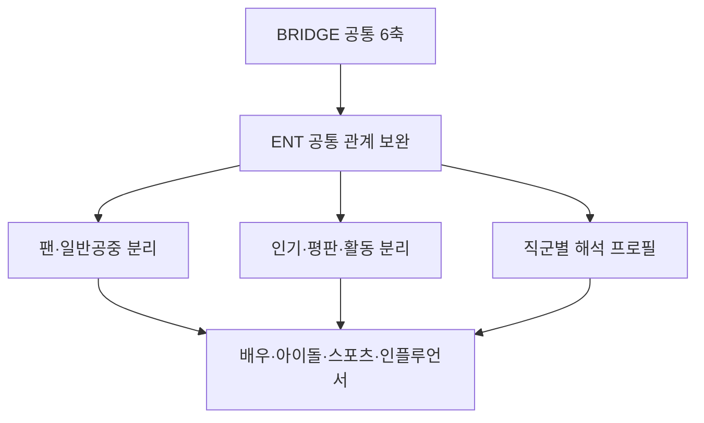

# BRIDGE 2단 방법론 구조

상태: 확정 원칙  
확정일: 2026-10-20  
적용 순서: UNI → GOV → ENT → CPR

## 1. 1차 공통층

CPR, GOV, UNI, ENT 모두에 동일한 BRIDGE 공통 골격을 적용한다.

- B·R·I·D·G·E 여섯 축
- 근거 원장과 대상·축·날짜 연결
- 동일 사건 중복 제거
- 직접 관측값, 유지값, 추정값, 참조값의 구분
- 신뢰등급과 관측 범위
- 시점, 버전, 정정 이력 관리
- 공통 공개 적격 기준과 재현성 검증

공통층은 분야 간 비교 가능성과 방법론적 일관성을 보장한다.

## 2. 2차 분야별 보완층

공통 철학과 점수 골격은 유지하되 CPR, GOV, UNI, ENT 각각의 관계 특성에 맞는 조작적 정의, 근거 유형, 귀속 규칙, 시간 구조를 보완한다. 분야마다 별개의 지수를 만드는 것이 아니라 공통 골격의 관측 정확도를 높이는 부분 맞춤형 계층이다.

### GOV 확정 보완

- 기능 맥락: 규제·서비스·지원·정책조정·지방행정의 관계 차이를 진단하되 가중치는 임의 변경하지 않는다.
- 경험 경로: 직접 서비스 경험, 제도 경험, 매체 경험, 대리 경험을 구분한다.
- E: 적법성, 절차적 공정성, 설명책임, 의견수렴 및 확인·계획·집행·감사·시정·재발의 생애주기
- R: 국민·주민 참여, 응답성, 상호통제, 의견의 실제 반영
- G: 기관간·민관 협업의 실제 공동 이행; 단순 업무협약은 낮은 강도의 연결 근거로만 기록
- D: 민원·신청·상담·신고·급부·허가·단속 등 직접 또는 의무적 공공서비스 경험
- 보조 진단: 이미지-실적 정합성과 공식 설명-외부 경험 정합성
- 혁신·ESG·전문성은 수상·홍보 표현이 아니라 공개적으로 확인된 행동과 결과가 있을 때만 관계 신호로 인정한다.

### UNI 확정 보완

- R: 신뢰, 만족, 상호성, 불신, 불만, 관계이탈
- I: 대학의 공식 정체성과 외부의 반복 연상 사이의 일치
- E: 사건의 시정, 이행, 회복, 재발이라는 시간 흐름
- B: 독립적 발견과 동일 사건의 반복 전재 구분

### ENT 구조도 보존안 (백서·운영 매뉴얼 반영 예약)

ENT 2차 보완층은 다음 구조를 공식 설명 도식의 원형으로 보존한다. 세부 수집요인과 점수 반영 규칙은 검토·병행 검증 후 확정하며, 이 도식 자체는 ENT 방법론을 한눈에 설명하는 백서·운영 매뉴얼용 구조도로 사용한다.

해설 원칙:

- 팬덤 내부 확산과 일반 공중으로의 확장을 구분한다.
- 인기, 화제성, 활동량과 관계 기반 평판을 동일한 개념으로 취급하지 않는다.
- 배우, 아이돌·가수, 스포츠 스타, 인플루언서·방송인의 직군별 본업 및 관계 맥락을 구분한다.
- 공통 BRIDGE 여섯 축, 공통 가중치, 공개 적격 기준은 유지한다.
- 추후 백서와 운영 매뉴얼에는 렌더링된 그림과 함께 조작적 정의, 근거 유형, 귀속 금지 규칙을 상세히 기록한다.

## 3. 변경 통제

- 분야별 보완은 공통 축의 의미를 훼손하거나 임의의 새 축을 만들지 않는다.
- 내부 가중치, 임계값, 공개 적격 기준은 별도 검증 없이 변경하지 않는다.
- 동일 입력에 대해 기존 결과와 보강 결과를 병행 산출하여 순위·점수 안정성과 설명력 개선을 검증한다.
- 자료가 없거나 수집에 실패한 값을 추정하여 채우지 않는다.
- 분야별 보완 근거는 원장부터 점수, 공개 JSON, 화면까지 추적 가능해야 한다.
- 보완층의 효과는 구성타당도, 변별타당도, 수렴타당도, 사건타당도, 강건성, 결측 편향, 귀속 정확도, 시간 안정성으로 검증한다.

## 4. 향후 문서화 의무

사용자가 백서, 운영 매뉴얼 또는 검증 프레임워크의 상세 개정을 요청하면 다음 내용을 반드시 포함한다.

1. 공통층과 분야별 보완층의 목적 및 경계
2. 분야별 공중 범위와 조작적 정의
3. 수집 가능한 근거와 제외 기준
4. 원장 기록 및 중복·귀속 처리
5. 점수 반영 여부와 변경 통제
6. 보강 전후 병행 검증 절차
7. 공개 가능한 설명과 비공개 지식재산의 경계
8. 한계, 정정, 버전 및 재현성 관리
